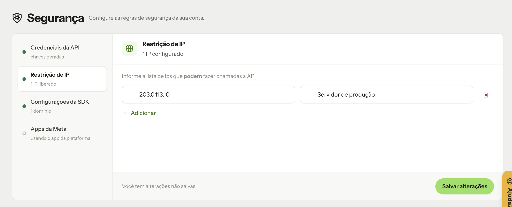

import { projectName } from '/snippets/variables.mdx';

IP restriction defines which addresses can call the {projectName} API. When it is on, a leaked Secret Key does not work outside the servers you allowed.

## How it works

- **Empty list:** any IP is accepted. This is the default.
- **With IPs registered:** only the IPs in the list can call the API. Calls from other addresses are rejected.
- **Exact match:** each IP is compared exactly as registered. Ranges and CIDR notation (for example, `203.0.113.0/24`) are not accepted: register each IP.
- **Scope:** the restriction applies to **all** calls authenticated with the **Secret Key**, from any IP: channels, messages, templates, flows and webhooks. No Secret Key route is left out.
- **IP considered:** the IP the connection reaches the API from. Headers such as `X-Forwarded-For` are ignored, so sending a different IP in them has no effect.
- **Time to take effect:** after you save, the new list can take **up to 10 minutes** to apply in the API. This applies to adding, removing or clearing the list. During that window, the previous rule may still apply. The [channel connection SDK](/en/channels/connect-channel), which uses the Public Key, is controlled by the [SDK authorized domains](/en/security/sdk-domains).

## Register the IPs

1. In the dashboard, open **Administration →** [Security](https://app.omni.z-api.io/app/security).
2. Open the **IP Restriction** tab and click **Configure now**.
3. Enter the IP and, optionally, a description to identify it. Click **Add** to include another IP.
4. Click **Save changes**.
5. The system asks for a **confirmation code** sent to you; enter the code to complete the change.

The Owner, the Administrator and the Access admin can change the IP list (see [Team and roles](/en/security/team)).

<Frame>
  
</Frame>

<Note>
  When moving to a new server, register the new IP **before** turning off the old one and wait up to 10 minutes. This way calls are not rejected during the switch.
</Note>

<Warning>
  Register the **outgoing IP** of the servers that call the API. If your environment changes IP (services with dynamic IP, for example), the API starts rejecting calls as soon as the IP changes.
</Warning>

## Response for a blocked IP

On the **Omni API** (`https://api.omni.z-api.io/v1/...`), when the call comes from an IP outside the list, the API responds `403` with `error` `ip_not_allowed` and a message with the source IP:

```json
{
  "error": "ip_not_allowed",
  "message": "203.0.113.10 not allowed: this workspace only accepts API calls from the IPs on its allow list. The workspace Owner can add this IP under Administration > Security > IP Restriction in the panel (changes take up to 10 minutes to apply), or call from an allowed IP. See https://developer.omni.z-api.io/en/security/ip-restriction"
}
```

If the source IP cannot be identified, the message starts with `ip not allowed:`.

To fix it, register the IP shown in the message or call the API from a server that is already allowed.

<Note>
  The `403` `ip_not_allowed` status is from the **Omni API**. On the [compatible Z-API route](/en/z-api/introduction) (`https://zapi.omni.z-api.io`) the IP allow list still applies, but the refusal comes as `400`: `{"error": "<ip> not allowed"}` when the source IP is identified and `{"error": "remote IP not allowed"}` when it is not.
</Note>
