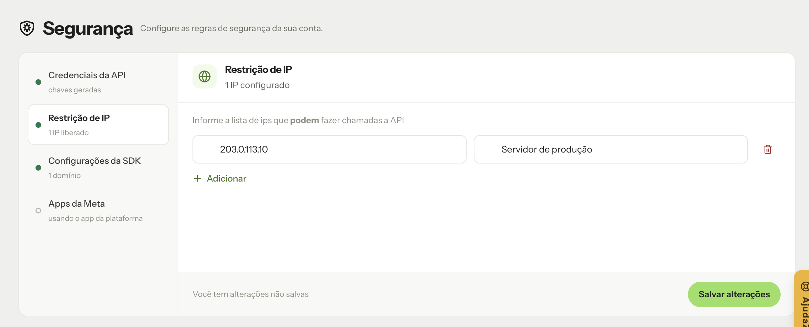

import { projectName } from '/snippets/variables.mdx';

A restrição de IP define quais endereços podem fazer chamadas à API do {projectName}. Com ela ativa, uma Secret Key vazada não funciona fora dos servidores que você liberou.

## Como funciona

- **Lista vazia:** qualquer IP é aceito. É o comportamento padrão.
- **Com IPs cadastrados:** só os IPs da lista conseguem chamar a API. Chamadas de outros endereços são recusadas.
- **Comparação exata:** cada IP é comparado exatamente como foi cadastrado. Faixas e notação CIDR (por exemplo, `203.0.113.0/24`) não são aceitas: cadastre cada IP.
- **Alcance:** a restrição vale para **todas** as chamadas autenticadas com a **Secret Key**, de qualquer IP: canais, mensagens, templates, flows e webhooks. Não existe rota com Secret Key que fique de fora.
- **IP considerado:** é o IP de onde a conexão chega à API. Cabeçalhos como `X-Forwarded-For` são ignorados, então não adianta informar outro IP neles.
- **Tempo para valer:** depois de salvar, a nova lista pode levar **até 10 minutos** para valer na API. Isso vale para adicionar, remover ou limpar a lista. Nesse intervalo, a regra anterior ainda pode ser aplicada. O [SDK de conexão de canais](/channels/connect-channel), que usa a Public Key, é controlado pelos [domínios autorizados da SDK](/security/sdk-domains).

## Cadastrar os IPs

1. No painel, abra **Administração →** [Segurança](https://app.omni.z-api.io/app/security).
2. Abra a aba **Restrição de IP** e clique em **Configurar agora**.
3. Informe o IP e, se quiser, uma descrição para identificá-lo. Clique em **Adicionar** para incluir outro IP.
4. Clique em **Salvar alterações**.
5. O sistema pede um **código de confirmação** enviado para você; informe o código para concluir a alteração.

Alteram a lista de IPs o Proprietário, o Administrador e o Admin de acesso (veja [Time e funções](/security/team)).

<Frame>
  
</Frame>

<Note>
  Ao mudar de servidor, cadastre o IP novo **antes** de desligar o antigo e aguarde até 10 minutos. Assim as chamadas não são recusadas na troca.
</Note>

<Warning>
  Cadastre o **IP de saída** dos servidores que chamam a API. Se o seu ambiente muda de IP (serviços com IP dinâmico, por exemplo), a API passa a recusar as chamadas assim que o IP mudar.
</Warning>

## Resposta para IP não liberado

Na **API Omni** (`https://api.omni.z-api.io/v1/...`), quando a chamada vem de um IP fora da lista, a API responde `403` com `error` `ip_not_allowed` e uma mensagem com o IP de origem:

```json
{
  "error": "ip_not_allowed",
  "message": "203.0.113.10 not allowed: this workspace only accepts API calls from the IPs on its allow list. The workspace Owner can add this IP under Administration > Security > IP Restriction in the panel (changes take up to 10 minutes to apply), or call from an allowed IP. See https://developer.omni.z-api.io/en/security/ip-restriction"
}
```

Se o IP de origem não puder ser identificado, a mensagem começa com `ip not allowed:`.

Para corrigir, cadastre o IP informado na mensagem ou faça a chamada a partir de um servidor já liberado.

<Note>
  O status `403` `ip_not_allowed` é da **API Omni**. Na [rota compatível Z-API](/z-api/introduction) (`https://zapi.omni.z-api.io`) a lista de IPs continua valendo, mas a recusa vem como `400`: `{"error": "<ip> not allowed"}` quando o IP de origem é identificado e `{"error": "remote IP not allowed"}` quando não é.
</Note>
